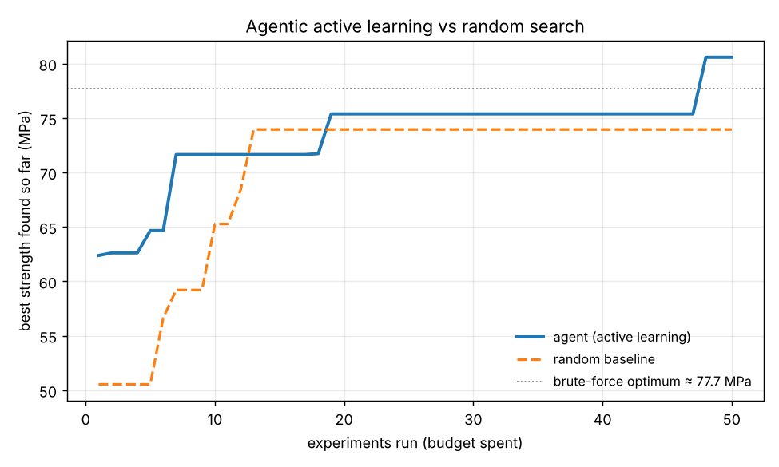

# Agentic Active Learning for Expensive Experiments

A compact, readable framework in which an **LLM agent orchestrates surrogate
models, uncertainty estimates and acquisition functions** to decide *which
experiments to run next* under a limited budget — with a transparent,
evidence-based rationale for every decision.

The loop is the one that drives modern scientific-agent systems such as
[ChemCrow](https://doi.org/10.1038/s42256-024-00832-8) (Bran et al., *Nature
Machine Intelligence*, 2024): **reason → pick a tool → act → observe → repeat.**
Here it is applied to a *benign* materials-engineering task — maximising
concrete compressive strength by choosing mix designs — but the agent is
domain-agnostic: swap the oracle and it plans a campaign for any expensive
evaluator.

```
initial design ──▶ ┌─────────────────────────────────────────────┐
                   │  fit surrogate (RF / GP, with uncertainty)  │
                   │            │                                │
                   │   agent decides strategy  ◀── campaign state │
                   │   (acquisition, kappa, surrogate, batch)    │
                   │            │                                │
                   │   score candidate pool (global + local)     │
                   │            │                                │
                   │   run top-k on the expensive oracle         │
                   └────────────┬────────────────────────────────┘
                                ▼  (repeat for N rounds)
                      report + convergence plot
```

## Why this project

It demonstrates the building blocks of **autonomous scientific orchestration of
virtual screening**, each mapped to a real component here:

| Screening concept | What it is in this repo |
|---|---|
| LLM agent for autonomous planning & tool use | [`src/agent.py`](src/agent.py) — Claude chooses the strategy each round; a deterministic heuristic planner is the offline fallback |
| Intelligent orchestration of methods | the agent switches between **acquisition functions** (UCB / EI / greedy / explore) and **surrogates** (random forest / Gaussian process) by campaign phase |
| Agentic active learning over a large library | each round samples a candidate pool and selects the most informative/promising points — [`src/campaign.py`](src/campaign.py) |
| Prioritise hits, guide the next round | **local refinement** (a trust-region idea) concentrates sampling around the best hits found so far |
| Explainable, evidence-based prioritisation | every selection is logged with predicted value, uncertainty, acquisition score and the agent's one-line rationale — see [`examples/demo_output/report.md`](examples/demo_output/report.md) |
| Uncertainty quantification | both surrogates return a mean **and** a standard deviation; uncertainty drives exploration |

The expensive experiment is a self-contained, physically-motivated function
(Abrams' water/binder law + a curing-time term + a localised optimum), so the
repo runs with **no network and no dataset download**, and the agent's result
can be scored against a brute-force reference optimum.

## Results

Across 10 random seeds, budget = 50 experiments, offline heuristic planner:

| strategy | final best (MPa) | reached ≥95% of optimum | 
|---|---|---|
| **agent (active learning)** | **76.0 ± 3.3** | **7 / 10 runs** |
| random search (same budget) | 71.9 ± 2.2 | 2 / 10 runs |

**Mean uplift: +4.1 MPa at equal budget.** The agent reaches near-optimal
designs more than three times as often as random search, because it learns the
response surface and concentrates its limited budget on promising regions.

A representative single run (seed 0):



Reproduce:

```bash
python benchmark.py --seeds 10 --budget 50      # the table above
python run.py --agent heuristic --seed 0        # the plot + report above
```

## Install

```bash
git clone https://github.com/Cyberboy22/agentic-active-learning.git
cd agentic-active-learning
pip install -r requirements.txt
```

Python 3.10+.

## Run

**Fully offline** (deterministic heuristic planner — no API key needed):

```bash
python run.py --agent heuristic
```

**With Claude as the planner** (the LLM makes the per-round strategy call):

```bash
export ANTHROPIC_API_KEY=sk-...
python run.py --agent llm
```

**Auto** — use the LLM if a key is present, else fall back to the heuristic:

```bash
python run.py --agent auto
```

Outputs land in `examples/demo_output/`: a convergence plot, a Markdown
report with the full per-round decision trail, and a machine-readable
`campaign_log.json`.

Useful flags: `--budget`, `--n-init`, `--n-rounds`, `--max-batch`, `--seed`,
`--pool-size`, `--out`. See `python run.py --help`.

## How the agent decides

Each round the agent receives a compact **campaign state** (budget spent, best
value so far, rounds since the last improvement, number of observations) and
returns a `Decision`: which acquisition function, which surrogate, the
exploration strength `kappa`, the batch size, and a one-sentence rationale.

- **LLM backend** ([`LLMAgent`](src/agent.py)) sends the state to Claude and
  parses a strict JSON reply. Any API or parsing error falls back to the
  heuristic planner, so a run never breaks.
- **Heuristic backend** ([`HeuristicAgent`](src/agent.py)) encodes standard
  active-learning intuition: explore early (high-kappa UCB), refine late
  (Expected Improvement), and fire a single exploration burst when progress
  stalls. It is deterministic and fully testable.

Both backends produce the same auditable rationale, which is the point: the
decisions are transparent, not a black box.

## Retargeting to another problem

The agent and loop don't know anything about concrete. To point the framework
at a different expensive experiment, edit [`src/oracle.py`](src/oracle.py):

1. redefine `SEARCH_SPACE` (your variables and their bounds),
2. replace `Oracle._ground_truth` with your evaluator (a simulator, an assay
   wrapper, a scoring function),
3. optionally adjust `is_feasible` for domain constraints.

Everything else — surrogates, acquisition, the agent, reporting — stays the same.

## Project layout

```
src/
  oracle.py       search space + the benign expensive experiment (+ local candidates)
  surrogate.py    RF and GP surrogates, each returning mean + uncertainty
  acquisition.py  UCB, Expected Improvement, greedy, pure-explore
  tools.py        the tool registry the agent orchestrates
  agent.py        LLM planner (Claude) + deterministic heuristic fallback
  campaign.py     the active-learning loop + random baseline
  report.py       convergence plot + Markdown/JSON report
run.py            CLI for a single campaign
benchmark.py      multi-seed agent-vs-random comparison
tests/            smoke + behaviour tests  (python tests/test_pipeline.py)
```

## Tests

```bash
python tests/test_pipeline.py      # or: python -m pytest -q
```

## Notes & honesty

- The oracle is a *synthetic* function, not a published dataset, so the repo is
  self-contained and the optimum is known. It is physically motivated but is
  not a validated engineering model.
- The brute-force reference optimum is **noise-free**; measurements include
  noise (σ = 1.5 MPa), so an individual measurement can sit slightly above it.
- The comparison that matters is agent vs random search at **equal budget**,
  averaged over seeds — reported above and reproducible with `benchmark.py`.

## License

MIT — see [LICENSE](LICENSE).
