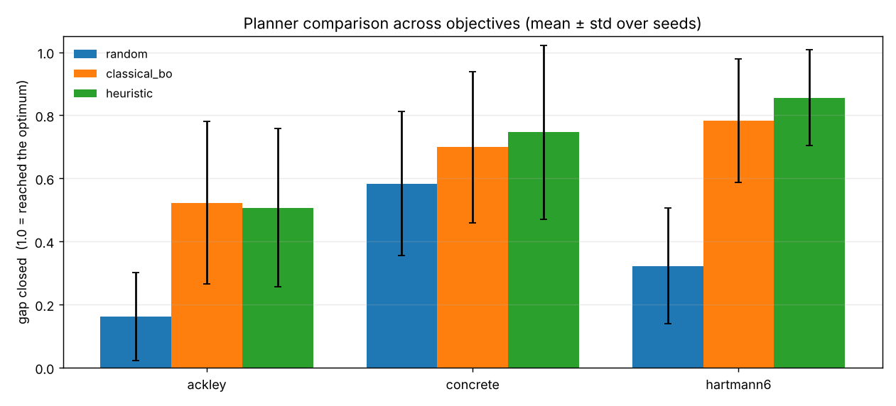

# Agentic Active Learning

**Infrastructure for autonomous scientific campaigns: an agent decides which
expensive experiments to run next, records why, and can prove the result is
reproducible.**

When every evaluation costs real time or money — a wet-lab assay, a long
simulation, a cluster job — the hard question is not *how do I run an
experiment* but *which experiment is worth running next*. This repository is a
small, readable framework for that decision: a planner orchestrates surrogate
models, uncertainty estimates and acquisition functions through a logged tool
registry, and every round it emits a decision **and the rationale behind it**.

The loop is the one behind modern scientific-agent systems such as
[ChemCrow](https://doi.org/10.1038/s42256-024-00832-8) (Bran et al., *Nature
Machine Intelligence*, 2024) — reason → pick a tool → act → observe → repeat —
with the parts a real lab needs bolted on: provenance, checkpointing, and an
honest benchmark of whether the agent's planning actually helps.

```
initial design ─▶ ┌────────────────────────────────────────────┐
                  │  fit surrogate  (mean + uncertainty)       │
                  │  planner decides this round's strategy ◀── campaign state
                  │  propose candidates (global + local)       │
                  │  score and select the top-k                │
                  │  spend budget: run the experiments         │
                  │  checkpoint                                │
                  └──────────────────┬─────────────────────────┘
                                     ▼ repeat
                     report · manifest · decision & tool logs
```

The framework is **domain-agnostic**. It ships with a benign materials
objective (concrete mix design) and four standard optimisation benchmarks, but
the experiment is behind an interface: implement three methods and every
planner, surrogate, report and provenance record works against your problem
unchanged.

## What it demonstrates

| Capability | Where it lives |
|---|---|
| LLM agent for autonomous planning and tool use | [`src/planners.py`](src/planners.py) — Claude picks each round's strategy; output is clamped to a legal range and falls back to a deterministic planner on any failure |
| Orchestration of methods | the planner switches between acquisition functions (UCB / EI / greedy / explore) and surrogates (random forest / Gaussian process) as the campaign evolves |
| Tool use, with an audit trail | [`src/tools.py`](src/tools.py) — any callable registers with a schema; every invocation logs name, arguments, duration and success |
| Active learning over a candidate pool | [`src/campaign.py`](src/campaign.py) — global exploration plus trust-region refinement around the best results so far |
| Uncertainty quantification | [`src/surrogate.py`](src/surrogate.py) — both surrogates return a mean **and** a standard deviation; uncertainty drives exploration |
| Explainable, evidence-based prioritisation | every selected experiment is logged with its prediction, uncertainty, acquisition score and the planner's rationale |
| Reproducibility | [`src/provenance.py`](src/provenance.py) — config hash, seeds, library versions, git commit; bit-exact resume from a checkpoint |
| Honest evaluation | [`src/benchmark.py`](src/benchmark.py) — paired multi-seed comparison with a Wilcoxon signed-rank test |

## Does the agent's planning actually help?

That is the question the benchmark exists to answer, and the answer is partly
"yes" and partly "not proven" — which is the honest result.

Four planners form a ladder:

- `random` — ignores the model; the floor
- `classical_bo` — textbook Bayesian optimisation (GP + Expected Improvement), fixed strategy
- `heuristic` — adaptive: explore early, refine late, exploration burst when stalled
- `llm` — Claude reads the campaign state and chooses the strategy itself

Run across 3 objectives × 20 seeds at an equal budget of 50 experiments. Every
planner starts each seed from the **same** initial design, so runs are paired
and differences reflect the decision rule alone. Scored by **gap closed**,
G = (best − init_best) / (reference − init_best): 0 means a planner never
improved on its starting sample, 1 means it reached the optimum.

**Aggregate across all three objectives (20 seeds each):**

| planner | mean gap closed |
|---|---:|
| `random` | 0.356 |
| `classical_bo` | 0.668 |
| `heuristic` | **0.703** |

**Per objective:**

| objective | `random` | `classical_bo` | `heuristic` |
|---|---:|---:|---:|
| ackley | 0.162 ± 0.140 | **0.523 ± 0.258** | 0.507 ± 0.251 |
| concrete | 0.584 ± 0.229 | 0.699 ± 0.239 | **0.746 ± 0.276** |
| hartmann6 | 0.322 ± 0.183 | 0.783 ± 0.195 | **0.856 ± 0.152** |



### What this actually shows

**Model-based planning decisively beats random search.** Both `classical_bo`
and `heuristic` close roughly twice the gap random search does, and the paired
tests are unambiguous on the harder landscapes (p < 0.001 on ackley and
hartmann6). Spending a little compute to decide what to measure next is clearly
worth it.

**The adaptive agent is *not* demonstrably better than textbook Bayesian
optimisation.** It wins on two objectives and loses slightly on the third, but
no paired comparison comes close to significance:

| objective | Δgap vs `classical_bo` | wins | p (Wilcoxon) |
|---|---:|---:|---:|
| ackley | −0.015 | 10/20 | 0.756 |
| concrete | +0.047 | 12/20 | 0.445 |
| hartmann6 | +0.073 | 11/20 | 0.294 |

**And that conclusion is the reason this harness exists.** At 10 seeds the
adaptive planner looked like a clear winner — +0.165 on concrete and +0.162 on
hartmann6, with an aggregate of 0.775 vs 0.679. Doubling to 20 seeds shrank
those margins to +0.047 and +0.073. The apparent advantage was mostly noise, and
a smaller study would have reported it as a result. Claiming "my LLM agent beats
Bayesian optimisation" would have been easy, premature, and wrong.

The useful open question is therefore not whether agentic planning *can* work —
it plainly does better than no planning — but whether its flexibility buys
anything over a well-tuned classical method, and on what kind of problem. These
benchmarks are smooth, low-dimensional and cheap. The case for an agent is
strongest where a fixed strategy cannot go: heterogeneous tools to choose
between, constraints that appear mid-campaign, evidence from outside the
numbers. Testing that needs harder, more realistic problems — which is what the
pluggable `Objective` interface is for.


Full tables, per-objective breakdowns and paired significance tests:
[`examples/benchmark_output/benchmark.md`](examples/benchmark_output/benchmark.md).

Reproduce:

```bash
python benchmark.py --seeds 20 --budget 50
```

## Install

```bash
git clone https://github.com/Cyberboy22/agentic-active-learning.git
cd agentic-active-learning
pip install -r requirements.txt
```

Python 3.10+.

## Run

**Fully offline** (deterministic planner, no API key needed):

```bash
python run.py --planner heuristic --objective concrete
```

**With Claude planning each round:**

```bash
export ANTHROPIC_API_KEY=sk-...
python run.py --planner llm
```

**Compare against classical Bayesian optimisation instead of random:**

```bash
python run.py --planner heuristic --baseline classical_bo
```

Outputs land in `examples/demo_output/`: a convergence plot, a Markdown report
with the full per-round decision trail, a run manifest, and machine-readable
`campaign_log.json` / `tool_calls.json`.

Objectives: `concrete`, `branin`, `hartmann6`, `ackley`, `rastrigin`.
See `python run.py --help` for the rest.

## Plugging in your own experiment

This is the entire integration surface:

```python
from src.objective import Objective, register_objective

@register_objective
class MyExperiment(Objective):
    name = "my_experiment"
    noise_std = 0.8                      # typical measurement noise

    @property
    def var_names(self): return ["temperature", "pressure", "time"]

    @property
    def bounds(self):
        return np.array([60., 1., 5.]), np.array([220., 20., 180.])

    def is_feasible(self, x):            # optional: cheap safety/validity filter
        return bool(x[0] <= 180. or x[1] <= 8.)

    def evaluate(self, x):               # your real experiment goes here
        return run_the_actual_thing(x)   # simulation, assay, cluster job, ...
```

`evaluate` is reached only through a budget-counting `Oracle`, so every call is
accounted for. Nothing else changes — planners, surrogates, acquisition,
provenance and reporting all work as they are. A complete worked example:
[`examples/custom_objective.py`](examples/custom_objective.py).

## Reproducibility and interrupted runs

Each campaign writes a `manifest.json` recording the exact configuration, a
hash of it, the seed, library versions and the git commit. Two runs with the
same hash and seed produce identical results; a changed hash tells you
immediately that the setup moved.

Every round is checkpointed, including the internal state of **both** random
generators, so an interrupted campaign resumes exactly where it stopped:

```bash
# start a long campaign, running only part of it now
python run.py --planner heuristic --out runs/my_campaign

# later, or after a crashed node:
python run.py --planner heuristic --out runs/my_campaign --resume
```

`stop_after_rounds` lets a campaign be run in chunks under a cluster wall-time
limit. A test (`test_checkpoint_resume_matches_an_uninterrupted_run`) asserts
that a resumed run is bit-identical to an uninterrupted one. Resuming with a
different configuration is refused rather than silently producing a mixture.

## Project layout

```
src/
  objective.py      the Objective interface + budget-counting Oracle + registry
  objectives/       built-in problems: concrete mix design, Branin, Hartmann6,
                    Ackley, Rastrigin
  surrogate.py      random-forest and Gaussian-process surrogates with uncertainty
  acquisition.py    UCB, Expected Improvement, greedy, pure-explore, random
  planners.py       random / classical BO / adaptive heuristic / Claude-driven
  tools.py          tool registry with schemas and call logging
  campaign.py       the active-learning loop, checkpointing and resume
  provenance.py     run manifest, config hashing, checkpoints
  report.py         convergence plot, Markdown report, JSON logs
  benchmark.py      multi-planner × multi-objective × multi-seed, with statistics
run.py              CLI: one campaign
benchmark.py        CLI: the planner comparison
examples/           committed demo output + a worked custom objective
tests/              18 tests (python tests/test_pipeline.py)
```

## Tests

```bash
python tests/test_pipeline.py      # or: pytest -q
```

Covers determinism under a fixed seed, bit-exact checkpoint resume, clamping of
malformed LLM output, tool-call logging, the paired-design property of the
benchmark, and plugging in a custom objective.

## Notes and honesty

- The concrete objective is a **synthetic**, physically-motivated function, not
  a fitted engineering model or a published dataset. It exists so the repository
  runs with no network and so the optimum is knowable.
- Reference optima are **noise-free**; measurements include noise, so a single
  measurement can sit slightly above the reference.
- The benchmarks are low-dimensional and cheap to evaluate, with a modest
  budget. They show whether a decision rule is sound — not how it behaves on a
  real campaign with expensive, noisy evaluations and a far larger search space.
- The `llm` planner is excluded from the default benchmark because it makes an
  API call per round; run it explicitly with `--planners ... llm`.

## License

MIT — see [LICENSE](LICENSE).
